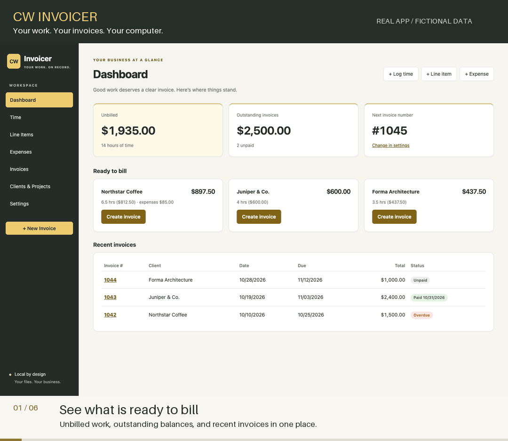
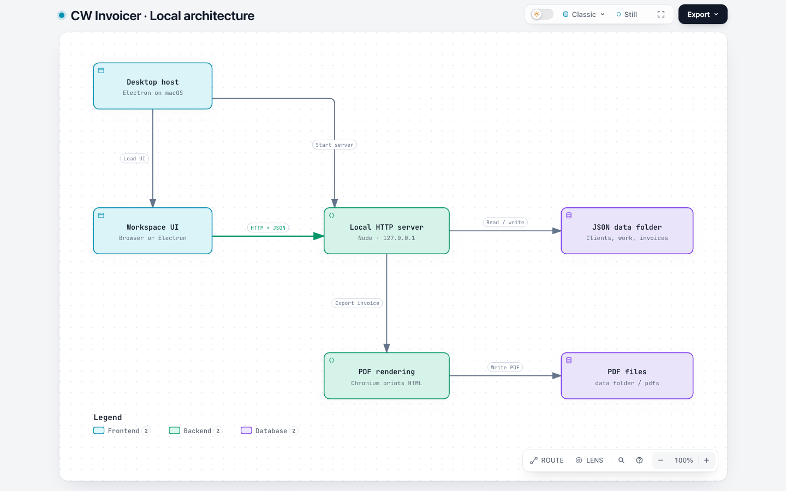

<p align="center">
  
</p>

<h1 align="center">CW Invoicer</h1>
<p align="center"><strong>Your work. Your invoices. Your Mac.</strong><br>
Local invoicing by Cory Webb Media. No accounts, no cloud service.</p>

<p align="center">
  <a href="#try-the-demo">Try the demo</a> ·
  <a href="#build-the-mac-app">Build the Mac app</a> ·
  <a href="docs/visual-guide.md">Visual tour</a> ·
  <a href="CONTRIBUTING.md">Contribute</a>
</p>



*A 24-second loop of real app captures with fictional demo data.*
[Static screenshots and walkthrough transcript](docs/visual-guide.md#animated-walkthrough) ·
[How the system works](docs/system.md)

Track time, line items and expenses. Turn unbilled work into clear invoices, export PDFs,
and keep the records in a folder you control. The desktop app runs its local server and
Chromium renderer inside Electron; the server uses only Node built-ins, and the browser UI is plain JavaScript.

| From work to payment | What the app handles |
| --- | --- |
| **Organize** | Clients, projects and hourly rate overrides |
| **Track** | Flexible time input, quantity × rate items and expenses |
| **Invoice** | Summary or detailed lines, editable descriptions and live preview |
| **Finish** | PDF export, printing, due dates and paid/unpaid status |
| **Review** | Invoice-date and client filters, paid/outstanding totals and CSV export |
| **Keep** | Plain JSON files, a chosen data folder and generated PDFs |

## Try the demo

With Node.js installed, clone the repository and start a disposable workspace:

```sh
git clone https://github.com/corywebb/cwinvoicer.git
cd cwinvoicer
npm run demo
```

Open the local URL printed in the terminal. No dependency installation is needed for the demo.
It creates **fictional clients and invoices in a fresh temporary folder**, separate from your
real data. Stop with Ctrl+C to discard it. The [visual tour](docs/visual-guide.md) shows what to expect.

## Build the Mac app

```sh
npm ci
npm run app      # run Electron without packaging
npm run dist     # create the .app and .dmg in dist/
```

Output names depend on your architecture; an Apple Silicon build produces
`dist/mac-arm64/CW Invoicer.app` and `dist/CW Invoicer-1.0.0-arm64.dmg`.
Drag the app into Applications. The build is unsigned; on first launch, right-click and choose **Open**.

The server uses a private local port. No Terminal or separate Chrome installation is needed
for the packaged app. PDFs use Electron's built-in Chromium and open in the default PDF viewer;
Print uses the macOS print dialog. Cmd+Q quits the app and server.

| Shortcut | Action |
| --- | --- |
| ⌘N | New invoice |
| ⌘T / ⌘L / ⌘E | Log time / add line item / add expense |
| ⌘1–⌘6 | Switch sections |
| ⌘, | Settings |

## Browser development

`npm start` runs the same server at <http://localhost:4242> and opens your browser.
Stop it with Ctrl+C. Browser PDF export uses an installed Chrome-family browser; use
`CHROME_PATH` for a custom executable, or **Print → Save as PDF** when none is available.
`PORT` changes the server port.

Normal browser and desktop modes use the same configured data folder. For an isolated manual workspace:

```sh
CWINVOICER_DATA="$(mktemp -d)" npm start
```

Use `npm run demo` when you want seeded examples and automatic cleanup.

## How it works

1. **Clients & Projects**: add clients with an hourly rate. Projects can override the client's rate.
2. **Log work**: add **Time** (hours like `1.5`, `1:30` or `90m`), **Line Items** (qty × rate) and **Expenses**.
   A time entry can override the rate. Otherwise the rate comes from the project, then the client, then the default in Settings.
3. **Create an invoice**: pick a client. Everything unbilled for that client starts selected; uncheck anything you don't
   want to bill yet. You can add time, line items or expenses right in the builder. Line descriptions can be edited
   before you create the invoice.
   - **Summary** format: one time line per project and hourly rate (hours × rate). A project's line items and expenses are combined into one
     additional line, labeled as items, expenses, or both. Time with no project is grouped by rate; items and expenses with no project are listed on their own.
   - **Detailed** format: every time entry, line item and expense with its date and own description, grouped under a
     bold heading for each project (oldest first). Entries with no project come last, under "Other".
   You can switch the format on an existing invoice too. The default is set in Settings.
4. When you create the invoice it gets the next number, and the selected entries are marked invoiced so they won't show
   up again. Deleting an invoice marks its entries as unbilled again.
5. On the invoice page you can **Open/Download PDF** (saved to the data folder's `pdfs/`),
   Print, Edit details, or Mark paid.

## Review and export your invoices

Open **Invoices** to filter by client, status, and invoice date. The totals show the
selected invoices' billed, paid, outstanding, and overdue amounts. **Export CSV**
downloads that selection for a spreadsheet or bookkeeper, including billed client
names, dates, totals, payment status, terms, and notes.

Date filters include both endpoints and use **invoice dates**, not payment dates.
The export is an invoice ledger; it is not a cash-receipts report or a full backup.
[Export columns, examples and data handling](docs/system.md#invoice-ledger-and-csv-export).

## How the pieces fit together

The Mac app starts a private Node server and opens the workspace in Electron.
The browser interface sends requests to that server, which validates records and
stores them as JSON. Invoice calculations and ledger filtering are shared between
the browser and server so the preview, stored totals, and export follow the same rules.

Creating an invoice links its source work and saves the billed rates and lines.
Marking it paid records a date; deleting it makes its work available for billing
again. PDF generation stays on your machine, using Electron or a local Chrome-family
browser. [Follow an invoice through the system](docs/system.md#follow-one-invoice).

## Invoice numbers

Numbers start at the **Starting invoice number** in Settings (1242 by default). After that, each invoice gets
`max(starting number, highest existing invoice + 1)`.

## Data

Everything is plain JSON in the data folder (by default `~/Library/Application Support/CW Invoicer/data`):

| File | Contents |
| --- | --- |
| `settings.json` | business details, starting number, default rate/terms/due days |
| `clients.json`, `projects.json` | clients and projects |
| `time.json`, `items.json`, `expenses.json` | work entries (`invoiceId` is set once billed) |
| `invoices.json` | invoices, with a copy of each line as it was billed |
| `logo.*`, `pdfs/` | uploaded logo and generated PDFs |

The desktop configuration is `~/Library/Application Support/CW Invoicer/config.json`; its
`dataDir` setting selects a custom folder. `CWINVOICER_DATA` overrides that setting.

Quit the app, then copy the entire data folder to back up everything. To move it (for example to iCloud Drive), use **File → Choose Data Folder…**
in the app. The current location is shown on the Settings page.


## Inside the repository

```text
cwinvoicer/
|-- electron/main.js       Mac window, menus, PDF and printing
|-- server.js              Loopback HTTP API and JSON persistence
|-- public/
|   |-- app.js             Workspace, forms and invoice builder
|   |-- lines.js           Shared invoice calculations
|   |-- ledger.js          Shared ledger filters, totals and CSV
|   |-- styles.css         Responsive workspace styles
|   `-- index.html         App shell
|-- lib/invoice-template.js  Printable invoice HTML
|-- scripts/demo.js        Disposable synthetic workspace
|-- test/                  Node regression tests
`-- docs/                  Screenshots and architecture source
```

<picture>
  <source media="(prefers-color-scheme: dark)" srcset="docs/images/architecture-dark.png">
  
</picture>

Explore the [architecture and interactive diagram](docs/visual-guide.md#architecture).
The server binds to loopback, checks the request host, and requires an app header for API writes.
This is a single-user local app, not a hosted multi-user billing service.

## Development checks

```sh
npm test
```

Tests use Node's built-in runner and temporary data folders. They cover rate precedence,
line grouping, HTML escaping, rebilling protection, invoice state transitions, print
error handling, date filters and spreadsheet-safe CSV exports.
See [CONTRIBUTING.md](CONTRIBUTING.md) for the browser checklist and fork-to-PR workflow.

## Contributors

- [Mike Hamanaka](https://github.com/hamanakam1)
