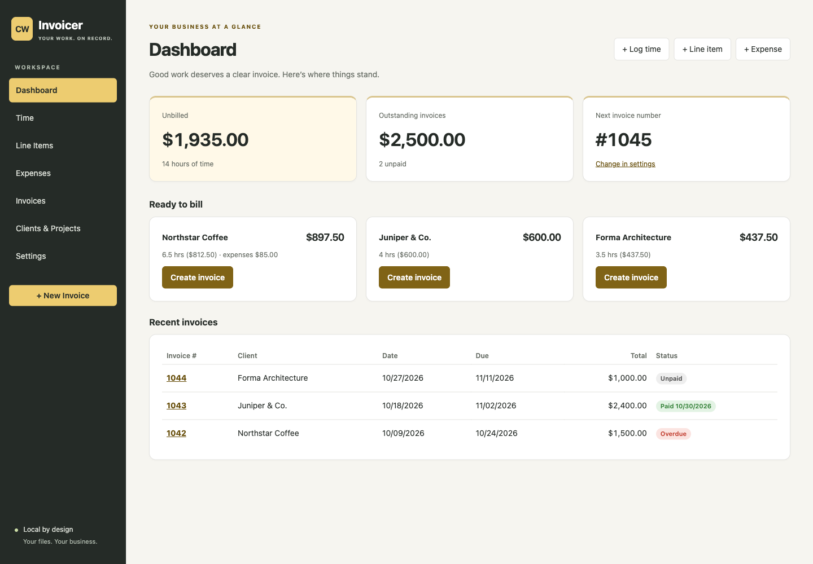
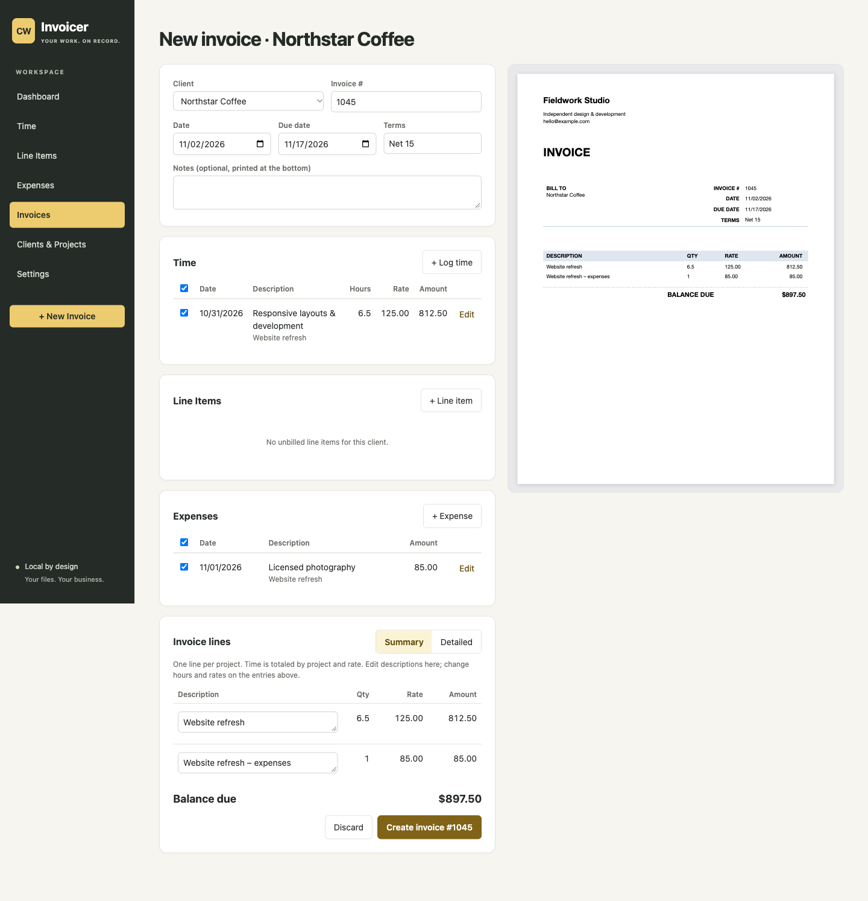
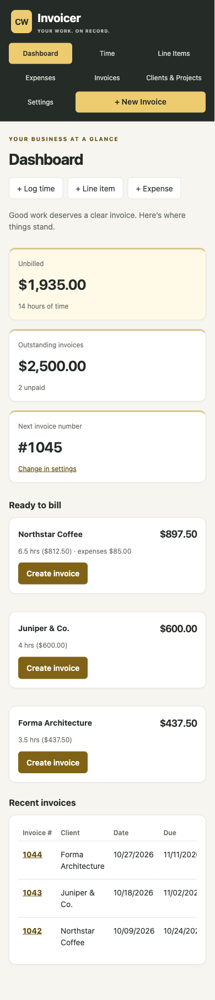
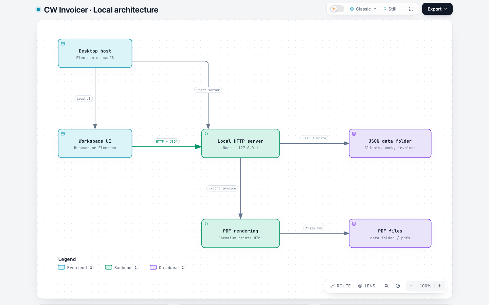
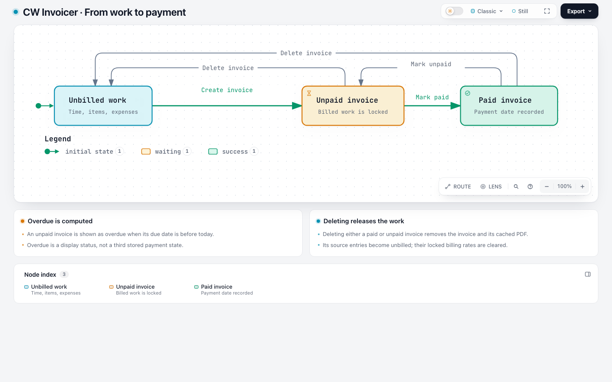

# Visual guide

All app screenshots show fictional **Fieldwork Studio** data produced by `npm run demo`.
They are browser captures of the application, not mockups. Dates are relative to the day the
demo starts. No business records are needed to reproduce the screens.

## Animated walkthrough

The README's [24-second animation](images/walkthrough.gif) is a sequence of real
browser screenshots, not a continuous screen recording. Each scene holds for four
seconds. The GIF is 1080 × 938 and approximately 736 KiB. Only captions and the progress strip are added; the application screens
are unchanged. All records are fictional and were captured on November 3, 2026.

For a motion-free version, use these original captures and the transcript:

| Scene | What happens | Static capture |
| --- | --- | --- |
| 1 | Review unbilled work and outstanding invoices on the dashboard. | [Dashboard](walkthrough/01-dashboard.png) |
| 2 | Review recorded time, its client/project, hours, and rates. | [Time](walkthrough/02-time.png) |
| 3 | Start Northstar Coffee's invoice with its unbilled time and expense selected. | [Builder](walkthrough/03-builder.png) |
| 4 | Create invoice #1045 for $897.50 and inspect its printable preview. | [Invoice](walkthrough/04-invoice.png) |
| 5 | Review the resulting four-invoice ledger and totals. | [Ledger](walkthrough/05-ledger.png) |
| 6 | Filter to October's unpaid invoices: two records totaling $2,500, then export CSV. | [Filtered ledger](walkthrough/06-export.png) |

The final CSV download was checked separately against those two records; a screenshot
of the export button alone is not proof of file contents. See [system details](system.md)
for date semantics, export fields, rate precedence, and storage boundaries.

### Rebuild the animation

The six original 1440 × 1000 captures are checked in under `docs/walkthrough/`.
The optional build script uses Pillow and its bundled font; it requires no network
or image-generation service once Pillow is installed:

```sh
python3 -m venv /tmp/cwinvoicer-docs-venv
/tmp/cwinvoicer-docs-venv/bin/pip install Pillow==12.2.0
/tmp/cwinvoicer-docs-venv/bin/python scripts/build_walkthrough.py
```

To refresh the captures, start a fresh `npm run demo`, set the browser viewport to
1440 × 1000, and follow the transcript in order. In the builder, create Northstar
Coffee's invoice without changing its selections. For scene 6, choose a date range
that includes the two original unpaid invoices but excludes the newly created one.
The demo dates move with today's date, so update the transcript dates when recapturing.
Capture after previews finish loading and transient messages disappear. Inspect every
scene before rebuilding. Keep screenshots synthetic; never use a real business folder.

## Workspace



## Build an invoice

The builder keeps source work and the printable preview beside each other at desktop widths.
At narrow widths the preview follows the form. Summary and detailed formats share the same
line-building module on the client and server.



## Narrow browser layout

Navigation becomes a compact grid. Cards stack, and wide tables scroll inside their own region.
This is browser responsiveness; the macOS desktop window still has a 900-pixel minimum width.



## Architecture

<picture>
  <source media="(prefers-color-scheme: dark)" srcset="images/architecture-dark.png">
  
</picture>

[Open the interactive diagram source](diagrams/architecture.html) ·
[Typed specification](diagrams/architecture.json) · [Verification receipt](diagrams/receipt.json)

GitHub displays HTML as source. Download the HTML file and open it locally for the interactive
viewer, themes, source links and export controls. It is self-contained and is not loaded by the app.
The diagram was generated with [Archify](https://github.com/tt-a1i/archify), with source references
pinned to Cory's initial commit. It describes that source architecture, not a running deployment.

The server reads and replaces JSON collection files. Invoice creation updates several files;
these writes are not a single database transaction. In desktop mode, Electron supplies a PDF
renderer; browser mode invokes an installed Chrome-family browser. The overview groups these
two PDF implementations into one operation and explains them in its detail cards.

## Invoice lifecycle

<picture>
  <source media="(prefers-color-scheme: dark)" srcset="images/invoice-lifecycle-dark.png">
  
</picture>

[Interactive lifecycle](diagrams/invoice-lifecycle.html) ·
[Typed specification](diagrams/invoice-lifecycle.json) ·
[Verification receipt](diagrams/invoice-lifecycle-receipt.json)

Creating an invoice locks its selected entries against editing or rebilling. Marking an invoice
paid records a payment date; marking it unpaid clears that date. Deleting either kind of invoice
releases its source work. **Overdue** is computed from an unpaid invoice's due date, rather than
stored as a separate payment state. The automated HTTP tests exercise these lifecycle operations.

## Refreshing the assets

1. Start `npm run demo` and open the printed URL in a browser.
2. Capture the dashboard at 1440 × 1000 as `images/dashboard.png`.
3. Choose **Create invoice** for Northstar Coffee and capture the full page as `images/invoice-builder.png`.
4. Return to Dashboard, resize to 390 × 844, and capture the full page as `images/mobile.png`.
5. Inspect every image for clipped content, correct totals and fictional data before committing.
6. If architecture changes, update the typed spec's source revision and references, regenerate
   with Archify, and refresh the diagram captures and receipt. Do not hand-edit generated HTML.

The checked-in receipt records deterministic validation and browser checks separately from
human visual inspection. Regeneration tooling is optional; running the app needs none of it.
